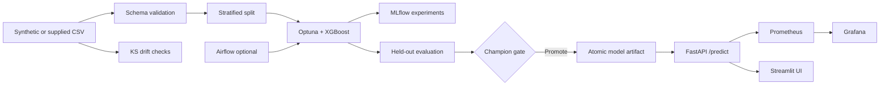

# 🧠 MLOps Control Center

> **Train → Tune → Evaluate → Promote → Serve → Monitor → Retrain**

   

An end-to-end, local-first **customer churn prediction MLOps portfolio** featuring Optuna + XGBoost tuning, MLflow experiment tracking, champion promotion, FastAPI serving, an interactive Streamlit dashboard, drift checks, Prometheus metrics, Grafana, CI tests, and an optional Airflow DAG.

**Data disclosure:** Synthetic, reproducibly generated customer data; no real customer information. Model scores are demo results, not production claims.

## Architecture



## Quick start (Python 3.11 recommended)

```bash
python3.11 -m venv .venv
source .venv/bin/activate  # Windows: .venv\Scripts\activate
pip install -r requirements.txt
python -m src.mlops.training --trials 10
```

To match the resume's **50+ MLflow runs**, use `--trials 50` (each trial creates one run plus a candidate evaluation run). Don't claim this count until you execute it.

Open **three terminals** in the project folder, activate the venv in each:

```bash
# Terminal 1: prediction API
uvicorn api.main:app --reload --port 8000
# Terminal 2: dashboard
streamlit run dashboard/app.py
# Terminal 3: experiment browser
mlflow ui --backend-store-uri sqlite:///mlflow.db --port 5000
```

Visit:
- Dashboard: http://localhost:8501
- Interactive API documentation: http://localhost:8000/docs
- MLflow runs: http://localhost:5000
- Health check: http://localhost:8000/health

### Example inference

```bash
curl -X POST http://localhost:8000/predict \
  -H 'Content-Type: application/json' \
  -d '{"tenure_months":12,"monthly_charges":95,"support_tickets":4,"usage_hours":18,"contract_monthly":1,"auto_pay":0,"satisfaction_score":2}'
```

## Docker monitoring stack (optional)

After running training locally, start the containers:

```bash
docker compose up --build -d
```

- Dashboard: http://localhost:8501
- API docs: http://localhost:8000/docs
- Prometheus: http://localhost:9090
- Grafana: http://localhost:3000 (local demo login `admin` / `admin`)

Grafana's Prometheus datasource is provisioned automatically. Create a panel using `rate(churn_predictions_total[5m])` or `rate(churn_prediction_seconds_count[5m])`. Change the demo Grafana password before exposing it to a network.

## Run tests and drift example

```bash
pytest -q
python -m src.mlops.drift
```

The drift example adds $35 to a sampled subset of the charge distribution; this is a **simulated distribution shift**, not real monitoring of incoming production data.

## Optional Airflow workflow

`dags/retrain_dag.py` defines a weekly retraining DAG. **Airflow is not included in the lightweight Docker Compose stack.** To use the DAG, run it in an Airflow environment with this repository mounted at `/opt/mlops` and project dependencies installed. This keeps the default local setup lightweight.

## Promotion policy and limitations

The training job uses a stratified train/test split, a separate validation split for Optuna, and a held-out test evaluation. A candidate replaces the current local champion when its test ROC AUC is at least the previous champion's recorded score. **For real production use, repeatedly comparing candidates on the same test set creates selection bias.** Use an independent promotion validation set, locked test set, minimum performance gates, approval, model registry, and rollback controls. The local job logs an MLflow candidate artifact but does **not** register versions in an MLflow Model Registry.

Model artifacts are Python joblib files and must only be loaded from trusted local sources. The dashboard and API have no authentication; do not expose them publicly.

## Repository structure

```text
api/                 FastAPI inference and Prometheus instrumentation
src/mlops/           synthetic data, training, tuning, drift, config
dashboard/           Streamlit operations UI
dags/                optional Airflow retraining DAG
monitoring/          Prometheus scrape config, Grafana datasource
tests/               reproducibility, drift, API validation
.github/workflows/   GitHub Actions CI
```

## Interview walkthrough

1. Describe why churn prediction is binary classification and why ROC AUC is useful.
2. Explain leakage prevention: tune on validation, report held-out test results.
3. Show individual Optuna trials in MLflow and the candidate artifact.
4. Explain champion replacement, its limitations, and safer production gates.
5. Send a request in `/docs`, observe API metrics, and use the dashboard.
6. Trigger the synthetic drift demo and explain KS test caveats.
7. Discuss Airflow scheduling, monitoring, rollback, auth, and data contracts as next steps.

## GitHub upload

```bash
git init
git add .
git commit -m "Build end-to-end MLOps training and inference platform"
git branch -M main
git remote add origin https://github.com/YOUR_USERNAME/mlops-control-center.git
git push -u origin main
```

Create an **empty** GitHub repository named `mlops-control-center` before running the remote/push commands. Never commit local data, database files, model artifacts, or secrets.

## Roadmap

- [ ] Production-grade MLflow model registry and approval flow
- [ ] Separate locked test and promotion sets
- [ ] SHAP explainability panel
- [ ] Persisted inference distributions and scheduled drift alerts
- [ ] Authentication, structured logging, distributed tracing
- [ ] Deployment to Kubernetes with rollout/rollback

## License

MIT (see LICENSE).
